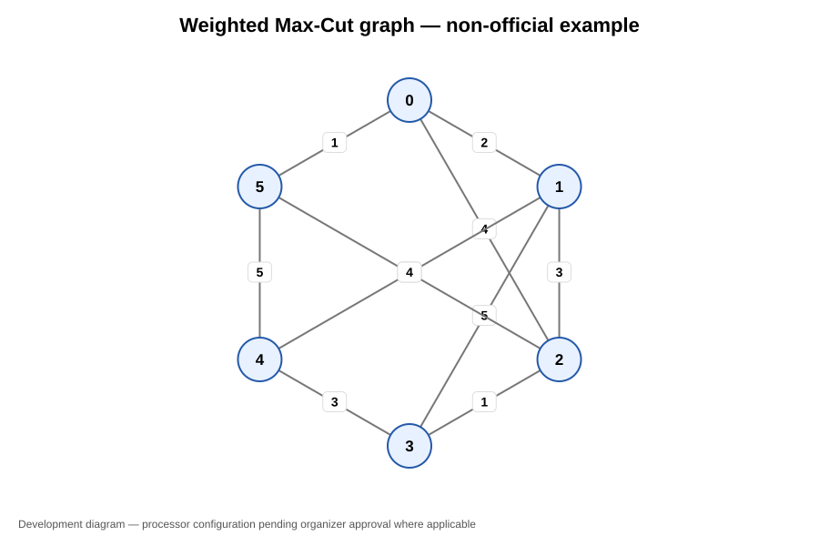
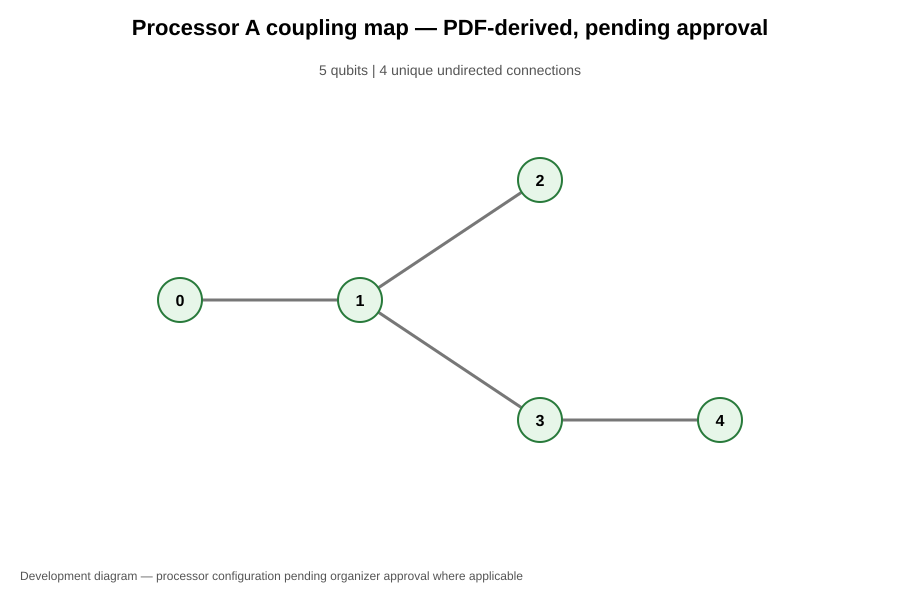
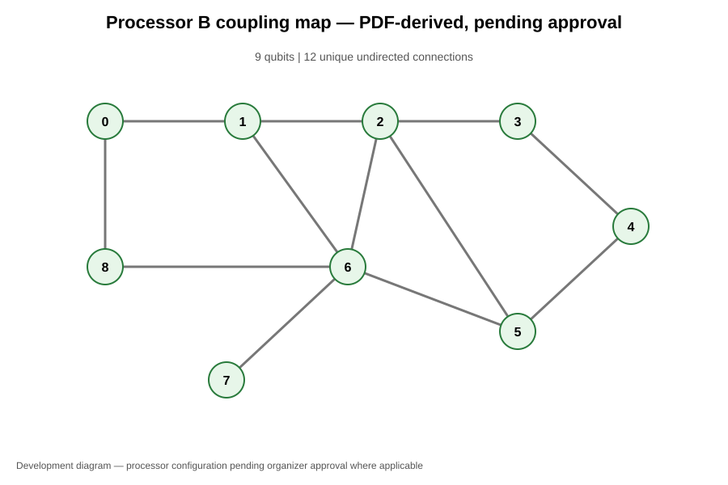

# QFF 2026 Phase 1 — PS-O1 Max-Cut Benchmark

## 1. Objective

Implement a reproducible Max-Cut experiment using QAOA and compare circuit compilation against the Processor A and Processor B connectivity configurations.

## 2. Method

- Framework: Qiskit and Qiskit Algorithms.
- Algorithm: QAOA, depth p=1.
- Classical optimizer: COBYLA.
- Random seed: 42.
- Classical reference: exhaustive search over all binary partitions.
- Compilation: Qiskit transpilation using the topology and development basis-gate assumptions in the local processor configuration files.
- Noise: not simulated.

## 3. Six-node example

The six-node weighted graph is a locally chosen reproducible example, not an organizer-provided official instance.

| Metric | Result |
|---|---:|
| Nodes | 6 |
| Edges | 10 |
| Exact classical Max-Cut | 24 |
| QAOA objective | 24.0 |
| Observed approximation ratio | 1.0 |
| Logical circuit depth | 6 |
| Processor B compiled depth | 43 |
| Processor B two-qubit gates | 38 |
| Processor B explicit SWAP gates | 0 |

One optimal partition is (0, 1, 1, 0, 1, 0).

Processor A has five physical qubits and cannot host this full six-qubit circuit. Processor B has nine physical qubits and was used for the six-qubit compilation.

## 4. Common five-node comparison

To compare both topologies on the same circuit, a five-node subproblem was compiled for both processors.

| Metric | Processor A | Processor B |
|---|---:|---:|
| Physical qubits | 5 | 9 |
| Compiled depth | 34 | 30 |
| Two-qubit gates (CX) | 26 | 23 |
| Explicit SWAP gates | 0 | 0 |

The subproblem's exact classical optimum was 15. QAOA returned 15.0, for an observed approximation ratio of 1.0.

For this compilation, Processor B had four fewer circuit-depth layers and three fewer CX gates. This is a topology-dependent compilation result, not evidence that physical hardware will perform better.

A reported explicit SWAP count of zero does not mean routing overhead is necessarily zero: routing can be represented through other basis gates.

## 5. Interpretation and limitations

1. Both graphs are local development examples, not official challenge instances.
2. Processor A and B connectivity was transcribed from the available configuration PDF and remains pending organizer approval.
3. The basis-gate lists are development assumptions and must be checked against the final challenge kit.
4. No hardware execution or noise simulation was performed.
5. The approximation ratio reported here uses the QAOA optimizer's returned objective value divided by the exact classical optimum. It is not a hardware-measured success probability.
6. A probability of measuring an optimal bitstring has not yet been reported.
7. The full six-node circuit cannot be mapped to Processor A because it has only five qubits.

## 6. Reproducibility artifacts

- `benchmark_ab.py`
- `compare_common_subproblem.py`
- `results/o1_reproducible_graph.json`
- `results/o1_ab_benchmark.json`
- `results/common_subproblem_comparison.json`
- `processors/processor_A.json`
- `processors/processor_B.json`

## 7. Before final submission

- Replace local example graphs with organizer-provided instances if available.
- Confirm Processor A/B configurations and basis gates with the final challenge kit.
- Add the required coupling diagrams and graph visualization.
- Include optimal-bitstring probability if required by the official scoring rubric.
- Review the final submission format and notebook requirements.

## Graph and processor topology diagrams

### Weighted Max-Cut graph

The graph below is a locally chosen reproducible six-node example. It is not an official organizer-provided benchmark.

### Processor A coupling map

Processor A is represented as a five-qubit connectivity graph with four unique undirected connections. The configuration is PDF-derived and pending organizer approval.

### Processor B coupling map

Processor B is represented as a nine-qubit connectivity graph with twelve unique undirected connections. The configuration is PDF-derived and pending organizer approval.

These are topology diagrams, not hardware-performance or noise visualizations. The basis-gate assumptions and noise parameters still require verification against the final organizer configuration.

## Optimal-bitstring probability

For the reproducible local example (not an official organizer-provided
benchmark), the exact noiseless statevector calculation gives:

- Exact Max-Cut optimum: **24**
- Optimized QAOA objective: **24.0**
- Probability of measuring any optimal bitstring: **15.9010%**
- Optimal bitstrings (in x0-to-x5 order): `011010` and `100101`
- Probability of each optimal bitstring: **7.9505%** and **7.9505%**

This is an ideal statevector probability, not a hardware-measured success
probability. No hardware noise or shot sampling is included. The graph is a
local reproducible example, not an official benchmark.
